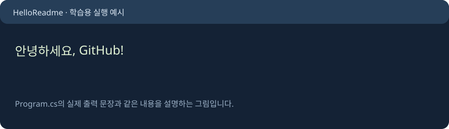

# csharp-readme-practice

> C# 콘솔 출력과 GitHub 문서 연결을 연습하는 학습 저장소입니다.

코드는 src, 그림은 assets, 상세 기록은 docs에 두고 이 README에서 연결합니다.

## 실행 화면



## 개발 기록 (매일 추가)

최신 날짜가 맨 위입니다. 상세 내용은 [개발 일지](./docs/개발일지.md)에서 확인합니다.

| 날짜 | 한 일 | 작성 문서 | PR |
| --- | --- | --- | --- |
| 2026-11-19 | 콘솔 인사 출력과 문서 연결 | [TIL](./docs/2026-11-19-콘솔출력/TIL.md) · [설명](./docs/2026-11-19-콘솔출력/설명.md) | 작성 전 |

## 바로가기

| 문서 | 무엇이 있나요 |
| --- | --- |
| [개발 일지](./docs/개발일지.md) | 날짜별 작업과 상세 문서 |
| [TIL](./docs/2026-11-19-콘솔출력/TIL.md) | WriteLine과 문자열 정리 |
| [기능 설명](./docs/2026-11-19-콘솔출력/설명.md) | 파일 역할과 실행 결과 |
| [소스 코드](./src/HelloReadme/Program.cs) | 실제 실행할 C# 코드 |

## 매일 하는 일 (리듬)

1. 작업 브랜치에서 코드와 상세 문서를 작성합니다.
2. docs/개발일지.md에 날짜와 문서 링크를 추가합니다.
3. README 개발 기록 표 맨 위에 요약을 추가합니다.
4. 실행과 링크를 확인한 뒤 커밋·푸시·PR을 진행합니다.

## 실행

필요 환경: .NET 10 SDK. **저장소 루트**에서 실행합니다.

```bash
dotnet run --project ./src/HelloReadme/HelloReadme.csproj -c Release
```

예상 출력: `안녕하세요, GitHub!`
